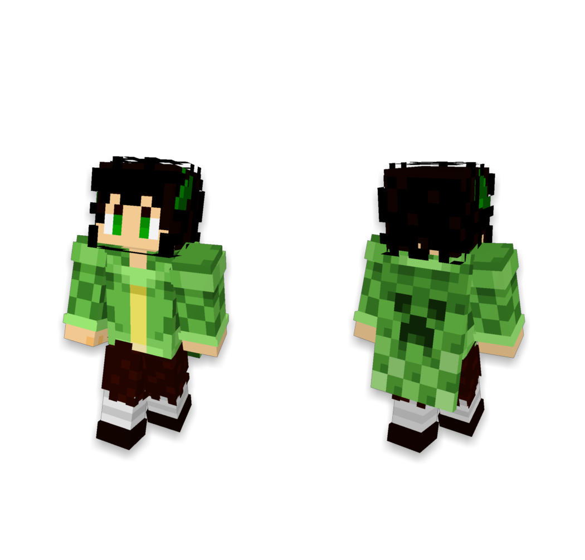

<div align="center">

# Fleece Render

简体中文 | [English](README_en.md)

使用Rust编写的Minecraft玩家模型渲染引擎

</div>

## 功能

- **3D 全身图**：支持 classic 和 slim 模型，可渲染披风或鞘翅，并可选择是否显示名称标签。可输出前视图、后视图或正反拼图，支持透明背景。
- **2D 头像**：输出 64×64 PNG，支持透明背景。
- **双层皮肤**：3D 全身图和 2D 头像均默认启用皮肤外层，也可只渲染基础层。
- **多种输入**：可按玩家名称或 UUID 从 Mojang 或 LittleSkin 获取皮肤，也可通过 URL、服务端本地文件、Base64、data URL 或图片字节提供皮肤纹理。

## 示例

3D 全身

```plain
GET http://127.0.0.1:57680/mojang/image/both
    ?name=LanYangYang_CN
    &style=3d
    &transparent=true
    &showName=false
```



2D 头像

```plain
GET http://127.0.0.1:57680/mojang/image/front
    ?name=LanYangYang_CN
    &style=avatar
    &transparent=true
```


## 快速开始

按[部署指南](docs/DEPLOYMENT.md#从源码运行)准备 Rust 工具链，然后在仓库根目录运行：

```sh
cargo run --release --locked -p fleece-render-server --bin fleece-render -- --host 127.0.0.1
```

服务地址为 `http://127.0.0.1:57680`。两种风格默认显示皮肤外层；查询参数 `showOuterLayer=false` 可只渲染基础层。渲染端点、请求示例、参数与返回格式见 [HTTP API 文档](docs/API.md)。构建脚本、Docker、配置和日志见[部署指南](docs/DEPLOYMENT.md)。

> 可在 `fleece-render.toml` 中设置 `server.auth_token` 启用 Bearer 认证（默认关闭，`/health` 始终无需认证）。仅向可信客户端开放服务。纹理输入支持读取服务端本地文件和请求远程 URL，请先阅读[部署安全边界](docs/DEPLOYMENT.md#安全边界)，不要直接暴露到公网。

### 可选 GPU 加速

在装有 Vulkan 驱动且服务进程可访问显卡的机器上，启用 `gpu` Cargo feature：

```sh
cargo run --release --locked -p fleece-render-server --features gpu --bin fleece-render -- --host 127.0.0.1 --backend gpu
```

`--backend gpu` 要求实际使用 GPU，无法初始化时启动失败；改用 `--backend auto` 可在 GPU 不可用时回退到 CPU。`avatar` 始终使用 CPU。详见[部署指南](docs/DEPLOYMENT.md#可选-gpu-后端)。

## 开发文档

- [架构设计](docs/ARCHITECTURE.md)：渲染核心、HTTP 服务和扩展接口。
- [渲染实现](docs/RENDERING.md)：模型、相机、纹理采样和头像合成。
- [开发与验证](docs/HANDOFF.md)：构建检查、测试与验收。

## 许可证

本项目的代码使用 [MIT 许可证](LICENSE)。内嵌字体使用 CC BY-SA 3.0；第三方代码和素材的来源及许可见[第三方声明](THIRD_PARTY_NOTICES.md)。

## 鸣谢

本项目受 [SerinaNya/SkinRenderMC](https://github.com/SerinaNya/SkinRenderMC) 启发，并沿用了该项目的 API 约定。

感谢 [bs-community/skinview3d](https://github.com/bs-community/skinview3d) 和 [bs-community/skinview-utils](https://github.com/bs-community/skinview-utils) 的作者与贡献者。
