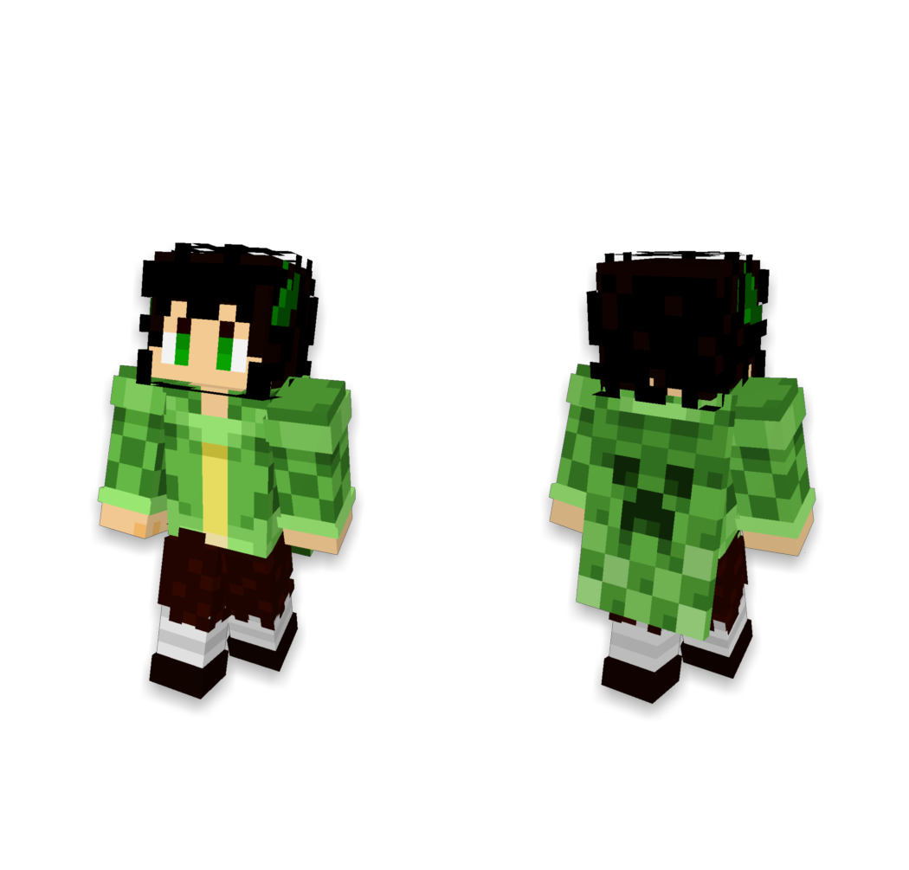

# fleece-render

[简体中文](README.md) | English

fleece-render is a **Minecraft player skin renderer** written in Rust. You can use its HTTP API or embed the rendering core as a Rust library. It runs without a browser or graphical interface, uses the CPU by default, and optionally accelerates 3D rendering with a Vulkan GPU.

The project and executable are both named `fleece-render`. The Rust workspace contains two Cargo packages: `fleece-render-core` provides the rendering library, and `fleece-render-server` uses it to serve HTTP requests.

## Features

- **Full-body 3D renders**: Supports classic and slim models, capes or elytra, and optional name tags. Output can be a front view, a back view, or a side-by-side image of both, with support for transparent backgrounds.
- **2D avatars**: Produces 64×64 PNGs with optional transparent backgrounds.
- **Two-layer skins**: Both full-body 3D renders and 2D avatars show the outer skin layer by default. You can also render just the base layer.
- **Multiple input formats**: Fetch a skin from Mojang or LittleSkin by player name or UUID, or provide a texture as a URL, a local file on the server, Base64, a data URL, or raw image bytes.

## Example

3D full body

```plain
GET http://127.0.0.1:57680/mojang/image/both
    ?name=LanYangYang_CN
    &style=3d
    &transparent=true
    &showName=false
```



2D avatar

```plain
GET http://127.0.0.1:57680/mojang/image/front
    ?name=LanYangYang_CN
    &style=avatar
    &transparent=true
```


## Quick start

Set up the Rust toolchain as described in the [deployment guide (Chinese)](docs/DEPLOYMENT.md#从源码运行), then run this command from the repository root:

```sh
cargo run --release --locked -p fleece-render-server --bin fleece-render -- --host 127.0.0.1
```

The service is available at `http://127.0.0.1:57680`. Both styles show the outer skin layer by default. Set the `showOuterLayer=false` query parameter to render just the base layer. See the [HTTP API reference (Chinese)](docs/API.md) for rendering endpoints, request examples, parameters, and response formats. For build scripts, Docker, configuration, and logging, see the [deployment guide (Chinese)](docs/DEPLOYMENT.md).

> Only allow trusted clients to access the service. Texture inputs can read local files on the server and fetch remote URLs. Read the [deployment security notes (Chinese)](docs/DEPLOYMENT.md#安全边界) before deploying, and do not expose the service directly to the public internet.

### Optional GPU acceleration

On a machine with Vulkan drivers and a GPU accessible to the service process, enable the `gpu` Cargo feature:

```sh
cargo run --release --locked -p fleece-render-server --features gpu --bin fleece-render -- --host 127.0.0.1 --backend gpu
```

With `--backend gpu`, the service fails to start if it cannot initialize the GPU backend. Use `--backend auto` to fall back to the CPU when the GPU is unavailable. The `avatar` style always runs on the CPU. For details, see the [deployment guide (Chinese)](docs/DEPLOYMENT.md#可选-gpu-后端).

## Developer documentation

- [Architecture (Chinese)](docs/ARCHITECTURE.md): Rendering core, HTTP service, and extension points.
- [Rendering implementation (Chinese)](docs/RENDERING.md): Models, cameras, texture sampling, and avatar compositing.
- [Maintainer handoff (Chinese)](docs/HANDOFF.md): Build checks, tests, and end-to-end verification.

## License

The project code is licensed under the [MIT License](LICENSE). The embedded font is licensed under CC BY-SA 3.0. See the [third-party notices](THIRD_PARTY_NOTICES.md) for the sources and licenses of third-party code and assets.

## Acknowledgments

This project was inspired by [SerinaNya/SkinRenderMC](https://github.com/SerinaNya/SkinRenderMC) and follows its API conventions.

Thanks to the authors and contributors of [bs-community/skinview3d](https://github.com/bs-community/skinview3d) and [bs-community/skinview-utils](https://github.com/bs-community/skinview-utils).
